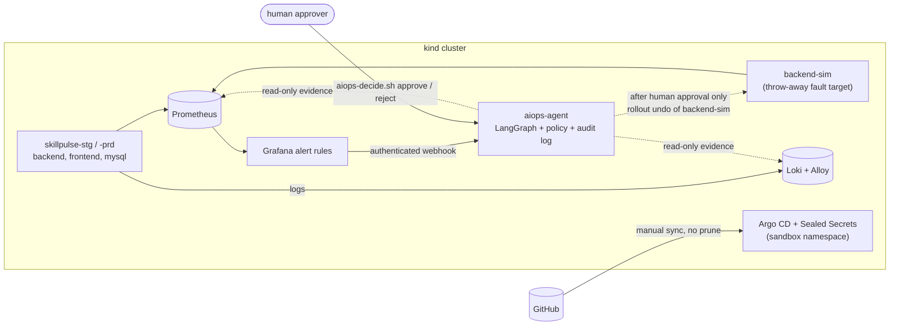

# SkillPulse — SRE / AIOps on Kubernetes

A small three-tier app (Go API, Nginx frontend, MySQL) turned into an **SRE portfolio project**: a CI/CD pipeline, a full
observability stack, GitOps delivery, and a **human-in-the-loop incident-response agent** built with LangGraph. Prometheus, Loki and
Grafana detect a failure; Grafana calls the agent; the agent gathers real evidence, diagnoses the cause, retrieves a runbook,
proposes a rollback, and **waits for a named human to approve it**. A policy file, not an LLM, decides what is allowed.

> **What this is not:** it is not autonomous self-healing, not production-ready, and it makes no MTTR-improvement claim. It runs on a
> local `kind` cluster and every number below is a single measured run. One real, human-approved rollback was demonstrated on a
> throw-away workload (`backend-sim`).

The application and its original GitHub Actions / Kubernetes tutorial material (from the TrainWithShubham masterclass) are kept
further down this page. Everything under `aiops/`, `monitoring/`, `gitops/` and `docs/aiops-*` is the SRE/AIOps work.

## Architecture



Detail: [`docs/aiops-architecture.md`](docs/aiops-architecture.md).

## Technologies

| Area | Used |
|---|---|
| App | Go (Gin), Nginx, MySQL 8.4 |
| CI/CD | GitHub Actions: Go tests, image build and push, Trivy scans that gate publishing, manifest pinning to the commit SHA |
| Orchestration | Kubernetes (kind), Kustomize overlays (dev / stg / prd) |
| Observability | kube-prometheus-stack (Prometheus, Grafana), Loki, Grafana Alloy (masks credentials before storage) |
| Incident response | Python, LangGraph (checkpointed state machine, `interrupt()` for approval), FastAPI webhook, BM25 runbook retrieval |
| GitOps / secrets | Argo CD (manual sync, no prune), Sealed Secrets (namespace-scoped) |
| Container security | Chainguard digest-pinned base, non-root, read-only filesystem, 0 Trivy findings on the agent image |

## How an incident flows

1. **Detect.** Grafana alert rules (CrashLoopBackOff, OOMKilled, pod running but not ready) fire from Prometheus metrics.
2. **Deliver.** Grafana posts to the agent's webhook with a Bearer token (fail-closed: no token configured, no service).
3. **Collect evidence.** Read-only: Kubernetes (pod state, events, **revision diff**), Prometheus (6 reproducible PromQL queries, plus
   proof the rollback target had Ready pods), Loki (log lines).
4. **Diagnose.** Deterministic rules classify the incident and name a suspected root cause (heuristic, uncalibrated confidence).
5. **Retrieve and propose.** BM25 picks a runbook; the proposal comes from a closed action registry (`rollout_undo`,
   `restart_deployment`, `propose_config_pr`, `escalate_human`).
6. **Decide.** The policy file applies mode, write allowlist, rate limit and confidence floor. Result: `requires_approval`.
7. **Approve.** A human runs `scripts/aiops-decide.sh approve <id> --approver <name> --confirm <id>`. The graph resumes from its
   checkpoint, re-checks policy, executes, and verifies recovery with two healthy polls.
8. **Audit.** Every step lands in a hash-chained, tamper-evident log; secrets are redacted.

## Safety controls

* **Human approval** for every real action; **autonomous mode is never enabled** (`auto_remediation_enabled: false`).
* **Deterministic policy** (`aiops/policies/policy.yaml`): the only workload the agent may write is `Deployment/backend-sim` in
  `skillpulse-stg`; production-like is never written; StatefulSets, PVCs, Secrets and Services are forbidden kinds.
* **Least-privilege RBAC:** one Role, `get`+`patch` on `deployments/backend-sim`. Verified with `kubectl auth can-i` and with real
  server-side dry-run patches as the agent identity (everything else is `Forbidden`).
* **Separate tokens** for the webhook and for approvals; untrusted alert text is sanitised and injection attempts are flagged.
* **Resting state is dry run:** after the one real rollback the agent was switched back to `approval` / `dry_run=true`.
* **Reversible, reviewed changes:** every cluster change was shown as a diff first (for example the Stage B change was exactly
  `AIOPS_DRY_RUN: "true" -> "false"`).
* **Secrets hygiene:** Sealed Secrets without a ClusterRole; demo database credentials found in Git history were rotated with a
  rehearsed, reversible procedure ([`docs/security-legacy-credential-rotation.md`](docs/security-legacy-credential-rotation.md));
  a test fails if the leaked values ever return.

## Results (measured, single runs on a laptop `kind` cluster)

| Scenario | Alert reached the agent | Diagnosis | Outcome |
|---|---|---|---|
| CrashLoopBackOff (`PORT=notaport`) | 119.3 s after injection | `crash_loop` / `invalid_configuration`, 0.9 | Approved by a human; **one real `rollout_undo`**; recovery verified 10 s after approval; audit chain valid |
| OOMKilled (memory limit 6Mi) | 103.3 s | `oom_killed` / `memory_limit_reduced`, 0.9 | Held at `requires_approval`; recovered manually; verified |
| Readiness probe failure (`/healthz` 404) | 216.0 s | `readiness_failure` / `probe_misconfigured`, 0.75 | Held at `requires_approval`; recovered manually; verified |

Detection time is dominated by Grafana's evaluation and pending period; the agent itself takes about 0.2 s. All runs, with Prometheus
and Grafana timings, are in [`docs/aiops-demo.md`](docs/aiops-demo.md). **No MTTR-improvement claim is made.**
GitOps: Argo CD synced the sandbox once by hand (8 objects, Healthy about 27 s later, no change to any existing resource).

## Testing

* `make aiops-venv && make aiops-test`: **366 tests** (unit, integration against fake Kubernetes/Prometheus/Loki, manifest and RBAC
  checks, safety and negative tests, a guard against leaked credentials). `make aiops-lint`: YAML, shellcheck, Python compile.
* Live checks scripted in `aiops/scenarios/` (`scenario.sh` inject / observe / recover / verify) and
  `aiops/scenarios/tools/approval_check.py` (27 approve checks and 13 reject checks, including invalid tokens and tamper attempts).
* The GitHub Actions workflows run the Go tests, build and scan the application images. The AIOps test suite runs locally through
  `make`; it is not wired into GitHub Actions.

## Honest limitations

Three incident families; lexical (not semantic) retrieval; faults shorter than about two minutes may not alert; heuristic confidence;
`kind` does not enforce NetworkPolicy; Argo CD's controller is cluster-admin equivalent (chart default) and manages only a sandbox
namespace; application images use `:latest`; local cluster only. The Terraform/AWS roadmap was deliberately not started.

## Documentation

| Document | What it covers |
|---|---|
| [`docs/aiops-architecture.md`](docs/aiops-architecture.md) | Components, data flow, the LangGraph workflow, policy, security model, limits |
| [`docs/aiops-setup.md`](docs/aiops-setup.md) | Build, test, install order, remediation stages, GitOps, troubleshooting |
| [`docs/aiops-demo.md`](docs/aiops-demo.md) | Guided demo of the three scenarios with measured timings |
| [`docs/aiops-learning-guide.md`](docs/aiops-learning-guide.md) | Beginner explanation of every part, labs, interview questions |
| [`docs/interview-and-demo-guide.md`](docs/interview-and-demo-guide.md) | Demo checklist and interview explanation |
| [`docs/security-legacy-credential-rotation.md`](docs/security-legacy-credential-rotation.md) | The credential exposure, rotation procedure and rehearsal |
| [`monitoring/README.md`](monitoring/README.md) | Loki, Alloy and Grafana install, backup/restore, rollback |
| [`aiops/scenarios/README.md`](aiops/scenarios/README.md) | The three fault scenarios (isolated to `backend-sim`) |

---

# The application and the original masterclass material

## SkillPulse — GitHub Actions & Kubernetes Masterclass (original tutorial)

A small, real application with a real CI/CD pipeline. The app — SkillPulse — lets you track skills you're learning and the hours you put in. The point isn't the app. The point is everything around it: how a single `git push` becomes a running update on a server in under two minutes, with no human pressing any button.

This repo is the working demo for the **TrainWithShubham GitHub Actions & Kubernetes Masterclass**.

> **New here? Two beginner-friendly companion guides:**
>
> - [`docs/skillpulse-cicd-guide.pdf`](docs/skillpulse-cicd-guide.pdf) — chapter one. 29 pages on the GitHub Actions pipeline: DevOps foundations, CI/CD, containers, deploying to a real EC2, plus resume + interview prep.
> - [`docs/skillpulse-kubernetes-guide.pdf`](docs/skillpulse-kubernetes-guide.pdf) — chapter two. 32 pages on running this app on a local `kind` cluster: Kubernetes primitives, manifest walkthrough, the dev loop, real failures we hit (arch mismatches, port collisions), interview prep.

---

## Why DevOps matters

For most of software's history, the people who *wrote* software and the people who *ran* it were two different teams with two different goals.

- Developers wanted to ship features.
- Operations wanted stability.

The fastest way for ops to be stable was to slow developers down. The fastest way for developers to ship was to throw code over the wall. Both teams were right. Both teams were also miserable. And the customer paid the price — releases happened once a quarter, every release was scary, and bugs took weeks to fix.

DevOps is the cultural and technical answer to that: *the same team owns the change all the way to production, and tooling makes that safe.* It's not a job title. It's a way of working that says small, frequent, automated, and reversible beats big, rare, manual, and irreversible — every time.

When DevOps is working you can tell because:

- **Deploys are boring.** Friday afternoon, Monday morning, doesn't matter.
- **Rollbacks are cheap.** A bad deploy is a 30-second fix, not an incident.
- **Feedback is fast.** A broken commit fails CI in minutes, not "after QA next sprint."
- **Ownership is clear.** The person who wrote the code is the person who watches it ship.

You get there by automating the path from a developer's laptop to production. That automation is called a **pipeline**.

---

## Why CI/CD is the heart of DevOps

CI/CD is two ideas wearing one acronym.

- **Continuous Integration** — every change, from every developer, gets built and tested automatically the moment it lands. You catch breakage in minutes, not days. Merge conflicts shrink because nobody's branch lives for two weeks.
- **Continuous Delivery / Deployment** — every change that passes CI is automatically packaged and shipped — to staging, or all the way to production. There is no "deploy day." Every commit is a candidate release.

The reason this matters: the cost of fixing a bug grows with the time between writing it and finding it. CI/CD shortens that gap to minutes. The reason it's hard: the only way to make it work is to *automate everything*. Build, test, package, deploy, verify. No "just run this script on my laptop" steps. If a human has to remember it, it will eventually be forgotten — and then it will fail at 2 a.m.

---

## Why GitHub Actions

A pipeline needs a runner — something that watches your repo, executes your build/test/deploy steps, and reports back. Historically that meant standing up a Jenkins server, paying for CircleCI, or wiring something custom. All of those still work; none of them are the lowest-friction option in 2026.

GitHub Actions wins on three things:

1. **It lives where the code lives.** No separate server, no separate auth, no separate UI. Your `.github/workflows/*.yml` files are part of the repo — they evolve with the code, get reviewed in the same PRs, and survive every clone.
2. **It's free for public repos and generous for private ones.** A complete CI/CD pipeline costs zero rupees to start.
3. **The Marketplace is enormous.** Need to SSH into a server? `appleboy/ssh-action`. Need to log in to Docker Hub? `docker/login-action`. You compose pre-built blocks instead of writing bash from scratch.

The trade-off is GitHub lock-in. For most teams, that's a fair price for the integration.

---

## What this project demonstrates

A real pipeline, end to end, in roughly 50 lines of YAML.

```
┌─────────────┐     git push        ┌──────────────────┐
│  Developer  ├────────────────────▶│  GitHub Repo     │
└─────────────┘                     └────────┬─────────┘
                                             │ on: push (main)
                                             ▼
                                    ┌──────────────────┐
                                    │  CI Workflow     │
                                    │  - build images  │
                                    │  - tag :sha      │
                                    │  - tag :latest   │
                                    │  - push to Hub   │
                                    └────────┬─────────┘
                                             │ workflow_run: success
                                             ▼
                                    ┌──────────────────┐
                                    │  CD Workflow     │
                                    │  - SSH to EC2    │
                                    │  - git pull      │
                                    │  - compose pull  │
                                    │  - compose up -d │
                                    └────────┬─────────┘
                                             │
                                             ▼
                                    ┌──────────────────┐
                                    │  EC2: live app   │
                                    │  http://<host>   │
                                    └──────────────────┘
```

### CI — `.github/workflows/ci.yml`

Triggered on every push to `main`. It does four things:

1. **Checks out the code.** A fresh clone in a clean Ubuntu runner — no laptop state to leak.
2. **Builds two Docker images.** A Go backend and an Nginx-served frontend. Both are multi-stage so the final images are small.
3. **Tags each image twice.** With the commit SHA (`:abc1234…`) and with `:latest`. The SHA tag is your rollback handle — you can always pin a deploy to an exact commit. The `:latest` tag is what production pulls.
4. **Pushes both to Docker Hub.** Authenticated with secrets (`DOCKERHUB_USERNAME`, `DOCKERHUB_TOKEN`) — never plaintext credentials in the repo.

The non-obvious lesson: **CI doesn't just test your code. It produces an artifact.** That artifact — the image — is what production runs. If the artifact is built consistently in CI, it's the same in dev, staging, and prod. "Works on my machine" stops being a possibility.

### CD — `.github/workflows/cd.yml`

Triggered automatically when CI completes successfully (`workflow_run` + a `conclusion == 'success'` gate). Skipped if CI failed — you cannot deploy a broken build.

It SSHes into an EC2 instance and runs:

```bash
if [ ! -d ~/skillpulse ]; then
  git clone <this repo> ~/skillpulse
fi
cd ~/skillpulse
git pull origin main
[ -f .env ] || { echo "ERROR: .env missing"; exit 1; }
docker compose pull
docker compose up -d
docker image prune -f
```

Every line earns its place:

- The `if [ ! -d ... ]` makes the script **idempotent** — the same script runs whether it's the first deploy or the hundredth.
- The `.env` check fails *loudly* with a useful message instead of letting `docker compose` produce a cryptic error about missing variables.
- `docker compose pull` brings in the image you just built. `up -d` only recreates containers whose image actually changed — backend and DB don't get bounced if you only edited frontend HTML.
- `docker image prune -f` keeps the EC2 disk from filling up with old image layers over weeks of deploys.

### Secrets used

| Secret | What it is |
|---|---|
| `DOCKERHUB_USERNAME` | Your Docker Hub account name |
| `DOCKERHUB_TOKEN` | A Docker Hub Personal Access Token with read+write scope |
| `EC2_HOST` | Public IP or DNS of the deploy target |
| `EC2_USER` | Linux user on the EC2 (typically `ubuntu`) |
| `EC2_SSH_KEY` | Private key contents — paste the entire `.pem` file as the secret value |

Set them at `Settings → Secrets and variables → Actions` on your fork.

---

## The application itself

A three-tier app — kept tiny on purpose so the pipeline is the star.

| Tier | Tech | What it does |
|---|---|---|
| Frontend | HTML + CSS + vanilla JS, served by Nginx | UI for adding skills and logging hours |
| Backend | Go 1.26 + Gin | REST API at `/api/...` |
| Database | MySQL 8.4 | Stores skills and learning logs |

Nginx in the frontend image also reverse-proxies `/api/` and `/health` to the backend, so the public surface is a single port (`80`).

API surface:

```
GET    /api/skills              list skills + total hours
POST   /api/skills              create skill
GET    /api/skills/:id          one skill + its logs
DELETE /api/skills/:id          delete skill (cascades logs)
POST   /api/skills/:id/log      log a study session
GET    /api/dashboard           summary counters
GET    /health                  DB ping for healthchecks
```

---

## Run it locally

```bash
cp .env.example .env             # then replace every CHANGE_ME with a random value (e.g. `openssl rand -hex 24`)
                                 # and set DOCKERHUB_USERNAME (anything works for local)
docker compose up -d --build
```

Open http://localhost. Backend port 8080 is intentionally not exposed — all traffic goes through Nginx, exactly like production.

To tear down:

```bash
docker compose down -v           # -v also drops the MySQL volume
```

---

## Run on Kubernetes (kind)

Same app, same images, same external port — but now every primitive a student would see in production: namespace, deployment, service, statefulset, configmap, secret, pvc.

**Prerequisites:** Docker Desktop running, plus `brew install kind kubectl`.

```bash
make up                          # creates the kind cluster + applies manifests
# visit http://localhost:8888
make down                        # deletes the cluster (and the MySQL data with it)
```

What `make up` actually runs, in order:

```bash
docker build -t trainwithshubham/skillpulse-backend:latest  ./backend
docker build -t trainwithshubham/skillpulse-frontend:latest ./frontend
kind create cluster --config k8s/kind-config.yaml --name skillpulse
kind load docker-image trainwithshubham/skillpulse-backend:latest  --name skillpulse
kind load docker-image trainwithshubham/skillpulse-frontend:latest --name skillpulse
kubectl apply -f k8s/00-namespace.yaml \
              -f k8s/10-mysql.yaml \
              -f k8s/20-backend.yaml \
              -f k8s/30-frontend.yaml
kubectl rollout status statefulset/mysql   -n skillpulse --timeout=180s
kubectl rollout status deployment/backend  -n skillpulse --timeout=120s
kubectl rollout status deployment/frontend -n skillpulse --timeout=60s
```

Notes on this flow:

- **`docker build` runs on your laptop**, producing images for your host's architecture (Apple Silicon → arm64; Intel/Linux → amd64). The cluster never has to deal with multi-arch.
- **`kind load docker-image`** copies each image into the kind node's containerd. `imagePullPolicy: IfNotPresent` on the Deployments means k8s reuses the loaded image and never tries to pull from Docker Hub.
- **`kind-config.yaml`** lives alongside the manifests for proximity, but it's a `kind` config — not a Kubernetes resource — so it's fed to `kind create cluster`, not `kubectl apply`.

Inner-loop after editing code: `make restart` rebuilds the images, reloads them into the cluster, and rolls the Deployments.

### How traffic flows

The cluster has **three nodes**: one control-plane and two workers (`skillpulse-worker`, `skillpulse-worker2`). Workloads schedule onto the workers — the control-plane is tainted `NoSchedule` by default, so it stays focused on the API server, scheduler, and controller-manager.

```
host browser            kind cluster (1 control-plane + 2 workers)
http://localhost:8888
        │
        ▼ (kind extraPortMappings on control-plane: hostPort 8888 → nodePort 30080)
   Service frontend (NodePort 30080)  — reachable on every node, kube-proxy routes
        │
        ▼
   Deployment frontend (nginx + static)  — runs on whichever worker the scheduler picks
        │ proxy_pass http://backend:8080  (same hostname as docker-compose)
        ▼
   Service backend (ClusterIP 8080)
        │
        ▼
   Deployment backend (Go + Gin)
        │ DB_HOST=mysql
        ▼
   Service mysql (Headless 3306)
        │
        ▼
   StatefulSet mysql + 1Gi PVC + ConfigMap-mounted init.sql
```

### Manifest layout

```
k8s/
  kind-config.yaml      cluster shape: 1 control-plane + 2 workers, host 8888 → node 30080
  00-namespace.yaml     namespace: skillpulse
  10-mysql.yaml         Secret + ConfigMap (init.sql) + headless Service + StatefulSet + 1Gi PVC
  20-backend.yaml       Deployment + ClusterIP Service, env from Secret, /health probes
  30-frontend.yaml      Deployment + NodePort Service (30080), / probes
```

### Useful commands

| Command | What it does |
|---|---|
| `make status` | One-screen view of pods, services, endpoints |
| `make logs` | Tail all three workloads at once |
| `make mysql` | Open a `mysql` shell in the StatefulSet pod |
| `make restart` | Roll backend + frontend (e.g. after pushing a new image) |

### Smoke test

```bash
curl http://localhost:8888/health                 # → {"status":"healthy"}
curl http://localhost:8888/api/dashboard          # → seed-data counters
curl -s http://localhost:8888/ | grep '<title>'   # → HTML title containing "SkillPulse"
```

### Gotchas worth knowing

- **Docker Desktop must be running.** `docker build`, `kind`, and `kubectl` all talk to the Docker daemon on your machine.
- **First boot is slow.** The local-path provisioner has to materialise the PVC before MySQL starts. Expect 10–30s of `Pending` on `make up`'s first run.
- **Host port collision.** If something else owns 8888 on the host, the cluster comes up but `curl localhost:8888` fails. Free the port — or change `hostPort` in `k8s/kind-config.yaml` and re-run `make down && make up`.
- **No Docker Hub round-trip in this chapter.** Images are built locally and pushed into the kind node via `kind load`. Useful when you're iterating on code: `make restart` rebuilds + reloads + rolls without ever touching Docker Hub. (Production EKS/GKE clusters do pull from a registry — that's the next chapter.)

### What's next

This is the **kind chapter** — same app, real Kubernetes primitives, but limited to one local node and `NodePort` access. The next chapter graduates the same workload to:

- An **Ingress** controller (nginx-ingress) so traffic enters via `Ingress` rules instead of NodePort.
- **Helm or Kustomize** so the manifests stop being copy-pasted between environments.
- A real **cloud cluster** (EKS / GKE / AKS) and CD that runs `kubectl apply` from the pipeline instead of `appleboy/ssh-action`.

---

## Continuous deployment to the kind cluster

The new CD path doesn't `kubectl apply` from GitHub Actions — your kind cluster lives on your laptop, GitHub can't reach it. Instead, the pipeline takes the GitOps shape: **the repo is the source of truth, your cluster is one `git pull && make apply` away**.

```
git push to main
    ↓
CI: build images, push trainwithshubham/skillpulse-{backend,frontend}:{latest,<sha>}
    ↓
cd-k8s.yml: sed image: lines in k8s/20-backend.yaml + k8s/30-frontend.yaml
            commit "deploy: pin backend+frontend to <short-sha>" to main as github-actions[bot]
    ↓
(you, locally):
    git pull && make apply
    ↓
kind nodes pull the new :<sha> from Docker Hub → rolling update
```

### How to wire it up on your fork

1. **Fork this repo + clone locally.** `make up` should work after that (see the [Run on Kubernetes (kind)](#run-on-kubernetes-kind) section).
2. **Add two secrets** to your fork (`Settings → Secrets and variables → Actions`):

   | Secret | Value |
   |---|---|
   | `DOCKERHUB_USERNAME` | your Docker Hub account name |
   | `DOCKERHUB_TOKEN` | a Docker Hub Personal Access Token with Read & Write scope |

3. **Set the repo variable** `DEPLOY_ENABLED = "true"` (`Settings → Variables → Actions`). Until this is `true`, CI builds without pushing and both CD workflows skip cleanly — the "dry run" state.
4. **Push any code change** (not a `.md`, not under `k8s/` or `docs/` — those are deliberately ignored by CI). Watch the Actions tab:
   - **CI** builds + pushes both images to Docker Hub.
   - **CD (kind cluster — manifest bump)** commits a `deploy: pin backend+frontend to <sha>` change to main.
5. **Pull and deploy**, on the laptop with the kind cluster:
   ```bash
   git pull
   make apply
   kubectl get pods -n skillpulse -o wide
   ```
   You'll see new pods with the bumped image rolling out. mysql untouched.

### What about the EC2 path?

The previous chapter's `cd.yml` is still in the repo — it SSHes into an EC2 and runs `docker compose up`. It's gated on the same `DEPLOY_ENABLED` variable plus three EC2 secrets (`EC2_HOST`, `EC2_USER`, `EC2_SSH_KEY`). Skip those secrets and `cd.yml` will fail loudly when `DEPLOY_ENABLED=true`; that's expected — it's the previous chapter's deploy target, kept around as the masterclass artifact.

### Break it on purpose to learn

- **Push a commit that fails to build** → both CD workflows are *skipped*, not failed (the `if: success()` gate).
- **Rotate the Docker Hub token** → next CI fails at the login step. You'll learn what an expired credential looks like in logs.
- **Edit `k8s/20-backend.yaml`'s image tag by hand and push** → CI is *skipped* (paths-ignore), `cd-k8s.yml` does fire but the manifest is already pinned, so it no-ops and exits 0. That's the loop-protection working.

---

## Project layout

```
backend/                Go service
  Dockerfile            multi-stage: golang:1.26-alpine → alpine:3.23
  main.go               wires routes, reads PORT env
  database/db.go        connects to MySQL with retry-loop
  handlers/             skills, logs, dashboard endpoints
  models/               request/response structs

frontend/               static UI + Nginx config
  Dockerfile            FROM nginx:alpine, copies html/css/js + nginx.conf
  index.html, css/, js/ vanilla — no build step
  nginx.conf            serves the site, proxies /api/ to backend:8080

mysql/init.sql          schema + seed data, mounted into the MySQL container

docker-compose.yml      three services: db, backend, frontend
.env.example            copy to .env

.github/workflows/
  ci.yml                build + push images on every main push
  cd.yml                SSH + redeploy on CI success
```

---

## Where this goes next

This is the **GitHub Actions** half of the masterclass. The pipeline currently deploys to a single EC2 via SSH + docker compose — a fine starting point, and the most common "first real pipeline" in the industry.

The Kubernetes half of the course evolves this same app onto a cluster:

- Replace `docker compose` with manifests (Deployment, Service, Ingress).
- Replace SSH-driven deploys with `kubectl apply` from CI, then with GitOps (Argo CD / Flux).
- Add health checks, autoscaling, rolling updates with no downtime, secrets via Kubernetes Secrets or external managers.
- Run the cluster on EKS / GKE / AKS or local (kind / minikube).

Same app. Same pipeline shape. Different runtime — and a lot more power.


---

## AIOps

See the **SRE / AIOps** overview at the top of this page and the documents it links.
Quick start: `make aiops-venv && make aiops-test`.

---

## Credits

Built for the [TrainWithShubham](https://www.youtube.com/@TrainWithShubham) community. If this repo helped you understand a real CI/CD pipeline end to end, share it forward — that's how the community grows.
