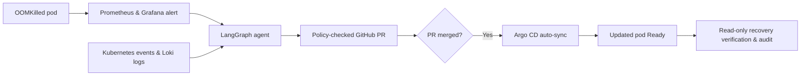

# SkillPulse — GitOps-Driven Kubernetes Self-Healing

**A hands-on DevOps, Platform Engineering and SRE project:** a three-tier application, Kubernetes observability, CI/CD, secure GitOps delivery and an incident-response agent that proposes fixes through GitHub pull requests instead of changing managed workloads directly.

**Stack:** Kubernetes (local `kind`) · Docker · GitHub Actions · Argo CD · Python / LangGraph · Prometheus · Grafana · Loki · Kustomize · Helm · Sealed Secrets

> **Validated on a local cluster, not production.** Four end-to-end GitOps recovery demonstrations succeeded on an isolated synthetic workload. The agent diagnoses incidents using deterministic rules and runbooks; its LLM provider is disabled. Recovery requires merging a PR, and the agent itself cannot modify the GitOps-managed Deployment.

## At a glance

| Capability | What is demonstrated |
| --- | --- |
| **CI/CD** | GitHub Actions builds, tests and scans application images; a required CI check protects changes to the GitOps demo branch |
| **Kubernetes** | Go API, Nginx frontend and MySQL, deployed with isolated environments on a three-node `kind` cluster |
| **Observability** | Prometheus metrics, Grafana alerts and Loki logs |
| **Incident response** | LangGraph workflow collecting Kubernetes events, metrics and logs; deterministic diagnosis and policy decisions |
| **GitOps recovery** | A GitHub PR changes one approved memory-limit manifest; after merge, Argo CD auto-syncs and a tracker confirms pod health |
| **Security** | Scoped RBAC, PR-only remediation, branch protection, Sealed Secrets, container scanning and hash-chained audit records |

## How self-healing works



The **agent never patches, restarts or rolls back** the Argo CD-managed `oom-demo` workload. Its permitted Git change is a one-line update to `k8s/gitops/oom-demo/patches/resources.yaml` (32Mi → 64Mi in these tests). The PR merge is the control point; Argo CD, not the agent, applies the new configuration. The demo uses automated sync **without pruning**, in the isolated `skillpulse-gitops` namespace.

See the [architecture and security design](docs/aiops-architecture.md) and [full GitOps recovery walkthrough](docs/aiops-gitops-recovery.md).

## Verified results

Four controlled `OOMKilled` recovery runs completed the same real path: Grafana alert → diagnosis → GitHub PR → merge → Argo CD sync → healthy pod. Recovery time is measured **from the first OOMKilled event to the new pod becoming Ready**.

| Trial | Recovery time | PR merge |
| --- | ---: | --- |
| [Run 1 — PR #3](https://github.com/riyan-ahmed/skillpulse-gitops-self-healing/pull/3) | **182 s** | Automated harness after scope checks |
| [Run 2 — PR #4](https://github.com/riyan-ahmed/skillpulse-gitops-self-healing/pull/4) | **338 s** | Automated harness |
| [Run 3 — PR #5](https://github.com/riyan-ahmed/skillpulse-gitops-self-healing/pull/5) | **535 s** | Automated harness |
| [Human-reviewed — PR #7](https://github.com/riyan-ahmed/skillpulse-gitops-self-healing/pull/7) | **884 s** | Repository owner, in GitHub UI |

The human-reviewed trial took **326 s excluding 558 s of review time**. The agent's alert-to-PR work took approximately **3–4 s** in the measured trials. Total recovery was affected mainly by Argo CD's Git polling and, in Run 3, a delayed Grafana notification. **No run recovered in under 90 seconds**, and these results are *not* production MTTR.

All four runs recorded linked PRs, revisions and a tamper-evident audit trail. The final report also records failures and limitations rather than omitting them.

**Quality evidence:** 426 automated tests passed; lint passed; six Argo CD manifests validated; the agent image 0.5.2 passed 34 container checks and had zero HIGH/CRITICAL Trivy findings in the reported scan. After the demonstrations, the local cluster's nodes and Argo CD applications were reported Healthy, with PVCs Bound.

[Measured stage timings, incident evidence and reproduction guide](docs/aiops-gitops-recovery.md) · [Raw records](docs/evidence/gitops-oom/) · [CV / interview explanations](docs/aiops-cv-and-interview.md)

## Repository guide

| Path | Contents |
| --- | --- |
| [`aiops/`](aiops/) | LangGraph agent, diagnosis rules, policy, tests, simulator and trial tools |
| [`gitops/`](gitops/) | Argo CD AppProjects and Applications |
| [`k8s/`](k8s/) | Kubernetes manifests, environment overlays and GitOps demo |
| [`monitoring/`](monitoring/) | Prometheus, Grafana, Loki and alert configuration |
| [`.github/workflows/`](.github/workflows/) | Build/test/security automation and `gitops-demo` validation |
| [`scripts/`](scripts/) | Demo, setup, backup and verification helpers |
| [`docs/`](docs/) | Detailed architecture, reproducible tests, security and learning guides |
| [`backend/`](backend/), [`frontend/`](frontend/), [`mysql/`](mysql/) | The underlying SkillPulse application |

### Reproduce the GitOps demonstration

**Prerequisites:** Docker Desktop, `kind`, `kubectl`, the tools and credentials described in the [setup guide](docs/aiops-setup.md), and the local `kind-skillpulse` cluster configured with the required observability and Argo CD components.

```bash
scripts/gitops-oom-demo.sh preflight
aiops/.venv/bin/python aiops/scenarios/tools/gitops_trials.py --human
```

The second command exercises the controlled fault and pauses at the generated recovery PR. **Review and merge the PR in GitHub**; Argo CD then syncs the change and the tracker records recovery. The harness can reset the demo through a CI-checked PR. Do not run the trial against production workloads. For setup, reset and troubleshooting steps, use the [complete runbook](docs/aiops-gitops-recovery.md).

**Important live-branch note:** Argo CD currently tracks `gitops-demo` for `oom-demo` and `feature/aiops-self-healing` for the older sandbox Application. Do **not** delete or rename those branches without deliberately updating the Applications first.

## Documentation

- [Start here: architecture](docs/aiops-architecture.md)
- [GitOps remediation, timing evidence and demo](docs/aiops-gitops-recovery.md)
- [Installation and operations](docs/aiops-setup.md)
- [Guided learning](docs/aiops-learning-guide.md)
- [CV and interview explanations](docs/aiops-cv-and-interview.md)
- [Original GitHub Actions & Kubernetes masterclass guide](docs/original-masterclass.md)

## Scope and limitations

This is a **portfolio demonstration** on one synthetic OOMKilled workload in a local `kind` cluster, not a production deployment. It proves a reviewable GitOps recovery path; it does not prove arbitrary self-healing, memory-leak diagnosis, multi-cluster resilience or statistical reliability. Trials 1–3 used scripted merges and predated branch protection; the fourth used a genuine human merge under required CI. The agent uses deterministic policies and diagnosis, not live generative-AI reasoning.

## Project origins

SkillPulse began from the [TrainWithShubham GitHub Actions & Kubernetes Masterclass](docs/original-masterclass.md). The original application/tutorial material is retained and credited. The observability, LangGraph incident response, GitOps remediation workflow, controlled demonstrations and supporting evidence are documented separately above.
