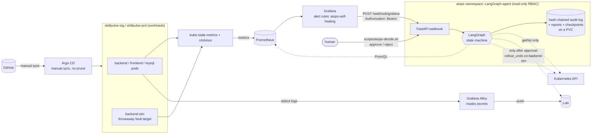
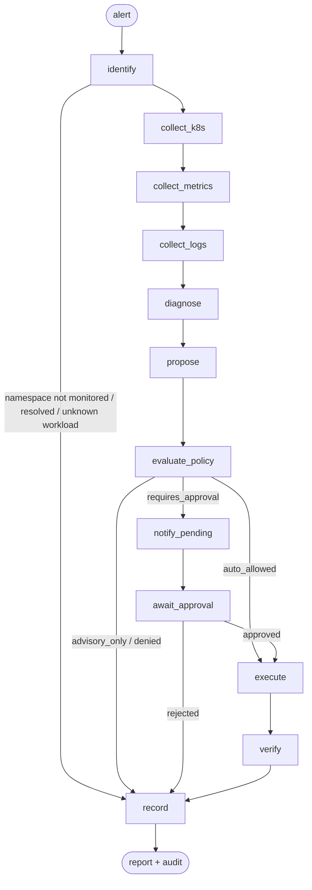

# SkillPulse AIOps: architecture

This document describes what is **actually built and running** in the repository: a safe, read-only-by-default
incident-response agent for the SkillPulse Kubernetes deployment. It detects Kubernetes incidents, collects
real evidence, diagnoses the likely cause, looks up a runbook, proposes a remediation, applies a deterministic
policy, optionally asks a human for approval, verifies recovery, and writes an audit log and a report.

Related documents: [setup](aiops-setup.md) · [demo](aiops-demo.md) · [learning guide](aiops-learning-guide.md) ·
[monitoring runbook](../monitoring/README.md) · [scenarios](../aiops/scenarios/README.md).

## 1. The system on one page

Solid arrows are data flows that exist today. Dotted arrows from the agent are API calls: today they are
**read-only**. The write path (last dotted arrow) exists in code and is tested. **Stage A is applied**: the agent runs in
`approval` mode with `dry_run=true` and one `get`+`patch` grant on `backend-sim`, so approvals are exercised against the
Kubernetes server-side dry-run API. A real rollback (Stage B) is **not enabled** (section 8).
Argo CD manifests are written and validated but **not installed** (section 9).

## 2. Components and why they were chosen

| Component | Role | Version / location | Why this choice |
|---|---|---|---|
| Prometheus + kube-state-metrics (existing) | Metrics: pod states, restarts, readiness, memory | kube-prometheus-stack 92.13.1 | Already installed; reusing it avoids a second monitoring stack |
| Grafana (existing, upgraded) | Alert rules and the webhook contact point | 13.2.4, `monitoring/aiops-grafana-values.yaml` | Alertmanager is disabled in this cluster; Grafana-managed alerts deliver webhooks without it |
| Loki | Log storage | chart 20.0.1 (app 3.7.9), monolithic, 2Gi PVC, 72h retention | Small, label-indexed, queried over HTTP |
| Grafana Alloy | Log collection | chart 1.14.3 | Promtail is end-of-life; Alloy tails pods through the Kubernetes API with namespaced RBAC and masks credentials before storage |
| LangGraph agent | The incident workflow | `aiops/agent/` (Python), image `skillpulse-aiops-agent:0.4.0` (v0.3.0 is what currently runs; v0.4.0 adds the approval section in reports and is built, not yet deployed) | An explicit, inspectable state machine with a built-in human-approval pause (`interrupt`) and checkpointing |
| BM25 retrieval | Runbook lookup | `aiops/agent/retrieval.py` | Real, deterministic, testable lexical retrieval. It is **not** semantic/embedding RAG and is not described as such |
| Policy engine | Decides what may ever run | `aiops/agent/policy.py` + `aiops/policies/policy.yaml` | Plain code, not an LLM: safety does not depend on model behaviour |
| Argo CD (not installed) | GitOps delivery | `gitops/argocd/` | Declarative, reviewable change path; manual sync only |
| Sealed Secrets (not installed) | Secrets in Git | `scripts/seal-db-secret.sh` | Encrypted manifests are safe to commit; works on a local kind cluster |

## 3. Signal path: from a failing pod to the agent

1. **A fault happens** (for example the container exits because of an invalid `PORT`).
2. **kube-state-metrics** exposes `kube_pod_container_status_waiting_reason{reason="CrashLoopBackOff"}`;
   **Prometheus** scrapes it every 30 s.
3. **Grafana** evaluates three rules every minute (folder *AIOps*, group `aiops-self-healing`):

   | Rule | Signal (per pod) | Pending |
   |---|---|---|
   | SkillPulse CrashLoopBackOff | `max_over_time(…waiting_reason{reason="CrashLoopBackOff"}[2m])` | 1 m |
   | SkillPulse OOMKilled | last terminated reason `OOMKilled` and restarts increased in 10 m | 0 s |
   | SkillPulse Pod Running But Not Ready | `kube_pod_status_ready{condition="false"}` and phase `Running` | 2 m |

   Each rule routes straight to the `aiops-agent` contact point (`notification_settings.receiver`), so the
   existing notification policy tree is untouched. The rules are **per pod on purpose**: during a bad rollout the old
   pod keeps serving, the Deployment still reports 1 available replica, and deployment-level rules never fire
   (measured on `backend-sim`).
4. **Grafana POSTs** to `http://aiops-agent.aiops.svc.cluster.local:8085/webhook/grafana` with a Bearer token
   read from a Secret through an environment variable.
5. The agent **authenticates** (constant-time compare), **sanitises** the payload, **deduplicates** by
   `namespace/workload` for 10 minutes, and starts the graph in a worker thread.

Alert names are only hints. Classification is always derived from live evidence.

## 4. The LangGraph workflow

State is a `TypedDict` (`IncidentState` in `aiops/agent/models.py`); nodes live in `build_graph()` in
`aiops/agent/graph.py`. A SQLite checkpointer on the PVC makes the pause for approval survive restarts.

| Node | What it does | Reads / writes |
|---|---|---|
| `identify` | Validates names, checks the namespace is monitored, resolves pod → ReplicaSet → Deployment from ownerReferences | Kubernetes (read) |
| `collect_k8s` | Deployment, pods, container states, events, ReplicaSet revisions and the **diff between the last two revisions**, previous container logs | Kubernetes (read) |
| `collect_metrics` | Six reproducible PromQL queries plus `was_ready` for the rollback target | Prometheus (read) |
| `collect_logs` | LogQL for the workload's pods; falls back to Kubernetes logs when Loki is unavailable | Loki (read) |
| `diagnose` | `classify()` (rules) then optional LLM explanation; BM25 runbook retrieval (skipped when unclassified) | none |
| `propose` | `propose_action()` picks one action from a closed registry | none |
| `evaluate_policy` | Deterministic decision: `advisory_only`, `requires_approval`, `auto_allowed` or `denied` | none |
| `notify_pending` / `await_approval` | Write the report, then `interrupt()` until a human decides | audit, checkpoint |
| `execute` | Re-validates and **re-evaluates policy** immediately before acting, verifies the rollback target again, then calls the Kubernetes API | Kubernetes (write, only if permitted) |
| `verify` | Polls until the Deployment is healthy twice in a row, or times out | Kubernetes (read) |
| `record` | Writes the incident JSON, the Markdown report and the closing audit event | audit |

Collector failures degrade the evidence (listed under *Collection problems* in the report); they never abort an
incident.

## 5. Diagnosis and decision

* **Classification** (`aiops/agent/classify.py`): OOM is checked first (an OOM loop also shows as
  CrashLoopBackOff), then CrashLoopBackOff, then Running-but-not-Ready. Sub-causes come from logs, events and the
  revision diff (`invalid_configuration`, `database_unreachable`, `memory_limit_reduced`, `probe_misconfigured`,
  `dependency_unavailable`, …). Confidence is a heuristic based on how many independent sources agree. It is not a
  calibrated probability.
* **Runbooks** (`aiops/runbooks/*.md`): chunked by heading and ranked with BM25 using terms from the *observed
  evidence*, not from the alert name.
* **Proposal**: `rollout_undo` only if a recent rollout changed the spec **and** the previous ReplicaSet is proven
  to have had Ready pods in Prometheus history (`max_over_time(kube_pod_status_ready…[24h])`); otherwise
  `escalate_human`. Database-unreachable and dependency-unavailable incidents are escalated, never restarted.
* **Optional LLM** (`AIOPS_LLM_PROVIDER`, off by default): it may only choose an incident-type enum and write an
  explanation, from redacted evidence framed as untrusted data. It cannot choose an action, a target or a command. A
  disagreement with the rules forces human approval; invalid output or an error falls back to the rules.

## 6. Policy and modes

`aiops/policies/policy.yaml` is reviewed like code. Deployment modes (`AIOPS_MODE`):

| Mode | Behaviour | Where used |
|---|---|---|
| `diagnose` (default) | Read-only. The decision is recorded as `advisory_only` with `would_be` shown | the default deployment (`kubectl apply -k aiops/`) |
| `approval` | A permitted action waits for a human decision | **running today with `dry_run=true`** (`k8s/aiops/approval-dryrun`); `approval-live` is not applied |
| `auto` | Allowlisted staging actions may run unattended; also needs `auto_remediation_enabled: true` | **disabled; never configured** |

`AIOPS_DRY_RUN=true` (default) turns execution into a server-side dry run. Rules enforced in code
(`Policy.evaluate`), in this order: valid action and parameters → namespace managed → kind supported (Deployment
only) → action allowed in that tier → write allowlist (`Deployment/backend-sim` in `skillpulse-stg` only) → not
Argo-CD-managed → confidence ≥ 0.6 → rate limit (2 executions per workload per hour) → approval or auto rules.
`backend`, `frontend`, MySQL and everything in production are never writable. Exhaustive tests walk every
namespace × workload × kind × action × mode combination.

## 7. Security model

| Control | Implementation |
|---|---|
| Untrusted input | Names validated against DNS-1123; labels whitelisted; text sanitised, truncated, scanned for instruction-like phrases (flagged, never obeyed); evidence passed to an LLM only as delimited data |
| No arbitrary commands | A closed action registry (`rollout_undo`, `restart_deployment`, `propose_config_pr`, `escalate_human`); targets come from the incident, never from parameters; typed Kubernetes API calls only, no shell, no `kubectl` |
| Least privilege | Namespace Roles only: read pods, events, logs, Deployments, ReplicaSets in stg and prd; **no** Secrets, ConfigMaps, exec, or any write verb. The one reserved write grant is `get`+`patch` on the single Deployment `backend-sim` (opt-in component) |
| Secrets | Webhook and approval tokens live in Kubernetes Secrets, are different values, and are consumed through `secretKeyRef`. Redaction runs on every audit write, every stored report, and in Alloy before logs reach Loki |
| Auditability | Append-only JSONL, each record hashed with the previous one (`verify_chain()` detects edits and deletions); every decision, approval, action and verification is recorded |
| Fail closed | Missing token → 503; wrong token → 401; missing required Secret → pod does not start; unknown action/kind/namespace → denied |
| Container | Non-root, read-only root filesystem, all capabilities dropped, no shell in the runtime image, digest-pinned Chainguard base, 0 Trivy findings |

## 8. Controlled remediation (Stage A dry run applied; real rollback not enabled)

* `k8s/aiops/approval-dryrun` and `k8s/aiops/approval-live` are kustomize overlays on the default deployment. They add
  only the narrow Role and set `AIOPS_MODE=approval` and `AIOPS_DRY_RUN` true or false. Autonomous mode is never set.
* A pending incident's report contains an *Approval required* section with the exact command. The human runs
  `scripts/aiops-decide.sh approve <id> --approver <name> --confirm <id>`; the approval token is read from the Secret
  into memory and never printed.
* On approval, `execute` re-checks policy, proves the rollback target was healthy, patches **only** `backend-sim`
  through the Kubernetes API, and `verify` confirms recovery. Everything is audited.

## 9. GitOps design (prepared, not installed)

* `k8s/gitops/{stg,prd,sandbox}`: thin overlays on `k8s/base` **without** the git-ignored `secretGenerator`. Rendered
  output is spec-identical to the live overlays; a read-only `kubectl diff` showed that a first sync would change
  exactly one thing per object: an added `argocd.argoproj.io/sync-options: Prune=false,Delete=false` annotation (no
  pod-template change, so no restarts).
* `gitops/argocd/project.yaml`: the allowed repo, three destination namespaces, **no** cluster-scoped resources, and
  `Secret` deliberately not whitelisted. `apps/*.yaml`: manual sync, no `automated`, no finalizer.
* **Persistent configuration changes go through pull requests.** `propose_config_pr` writes a one-file patch
  (`k8s/gitops/<env>/patches/backend-resources.yaml`) and opens a GitHub PR when enabled (disabled by default; in
  dry-run it writes only a local proposal). A human merges, then syncs in Argo CD by hand.
* The agent will not touch a workload that carries Argo CD tracking metadata: that change must go through Git.
* Secrets: `scripts/seal-db-secret.sh` turns the git-ignored env file into an encrypted `SealedSecret`.

## 10. Data and state

| Data | Where | Notes |
|---|---|---|
| Audit log, incident JSON, reports, LangGraph checkpoints | PVC `aiops-data` (100Mi) in `aiops` | Redacted; hash-chained; survives agent upgrades |
| Logs | Loki PVC (2Gi, 72 h) | Credentials masked by Alloy before storage |
| Grafana state | PVC `grafana-data` (1Gi), created outside Helm | Rollback and uninstall cannot delete it; backups in `aiops/audit/` (git-ignored) |

## 11. Resource footprint (measured on the kind cluster)

| Pod | Memory (working set) | CPU requests |
|---|---|---|
| aiops-agent | about 135 MiB | 50m |
| loki-0 | about 83 MiB | 50m |
| alloy | about 144 MiB (+7 MiB reloader) | 60m |
| Grafana (3 containers, no limits) | about 550 MiB main + 160 MiB sidecars | none set |

## 12. Known limitations

* Detection takes about 2 minutes end to end (scrape + 1-minute evaluation + pending period + group wait) and a fault
  shorter than that may not alert. This is the price of avoiding flapping alerts.
* Heuristic classification covers three incident families; everything else is `unclassified` and escalated.
* Retrieval is lexical; the runbooks are short and curated.
* Deduplication is in memory (10-minute window): a second, different failure on the same workload inside the window
  joins the open incident, and a restart of the agent forgets the window.
* kind does not enforce NetworkPolicy, so the webhook's only barrier is its Bearer token.
* Kubernetes Secrets are only base64-encoded at rest on this cluster.
* Grafana runs with a `RollingUpdate` strategy (`maxSurge 0`) rather than `Recreate`; see the SQLite overlap note in
  [`monitoring/README.md`](../monitoring/README.md).
* Single-run measurements only; nothing here supports an MTTR-improvement claim.
