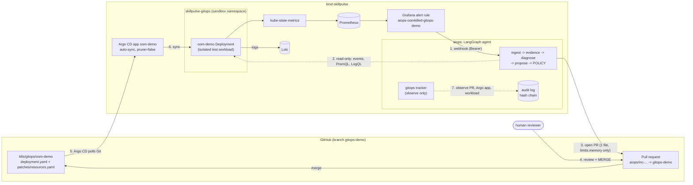

# GitOps-driven recovery of an OOMKilled workload

This is the one place in the project where the agent's remediation **leaves the cluster entirely**. The agent diagnoses an
`OOMKilled` failure and opens a **GitHub pull request**; a **human merges it**; **Argo CD** applies the merge. The agent
never patches, rolls back, restarts or syncs anything. It then *observes* the recovery and writes the whole timeline to its
hash-chained audit log.

Related: [architecture](aiops-architecture.md) · [setup](aiops-setup.md) · [demo](aiops-demo.md).

## 1. What is built



| Piece | Where | Role |
|---|---|---|
| `oom-demo` workload | `aiops/demo/oom-demo/` (image), `k8s/gitops/oom-demo/` (manifests) | Synthetic service whose memory demand is `ALLOC_MB`. 12 MiB is healthy under a 32Mi limit; 40 MiB is OOMKilled. Not part of SkillPulse. |
| Argo CD `Application oom-demo` | `gitops/argocd/oom-demo/application.yaml` | **Automatic sync, `prune: false`**, no `selfHeal`, no finalizer, own `AppProject` (Deployment only, sandbox namespace only). The existing manual-sync estate is untouched. |
| Grafana rule `aiops-oomkilled-gitops-demo` | `monitoring/aiops-grafana-values.yaml` | Own group evaluated every 10 s; routes to the existing `aiops-agent` contact point. |
| Policy | `aiops/policies/policy.yaml` | `skillpulse-gitops`: empty write allowlist, only `propose_config_pr` / `escalate_human`, memory cap 512Mi, one allow-listed target file. |
| PR module | `aiops/agent/gitops.py` | Creates a branch, writes **one** file, opens the PR. Path must be under `k8s/gitops/`. No merge call exists. |
| Tracker | `aiops/agent/gitops_verify.py` | After the PR: waits for the merge, the Argo CD sync of *that* commit, a healthy workload running the *proposed* limit; records each step. |
| Overlay | `k8s/aiops/approval-gitops-pr/` | Turns on the PR path. Cluster writes stay in server-side dry run; mode stays `approval`; autonomy stays off. |

## 2. Automatic diagnosis, human approval, GitOps recovery: three different things

| | Who/what does it | Evidence it happened | Can it change the cluster? |
|---|---|---|---|
| **Automatic diagnosis** | The agent, within seconds of the alert: reads Kubernetes events and pod state, runs PromQL, reads Loki, classifies deterministically (`oom_killed` / `memory_limit_exceeded`), retrieves the runbook, proposes `propose_config_pr` with limit x2 capped at 512Mi, and the **policy file** (not an LLM) permits a PR. | `diagnosis`, `action_proposed`, `policy_decision` audit events | **No.** Read-only RBAC. |
| **Human approval** | A person reviews the PR (root cause, evidence, one-file diff) and **merges it**. The agent has no merge permission and no code path that merges. | GitHub `merged_by` / `merged_at`, audit event `pr_merged` | Not by itself: a merge changes Git only. |
| **GitOps recovery** | **Argo CD** notices the new commit on `gitops-demo`, renders the Kustomize patch and applies the Deployment. Kubernetes rolls the pod. | `argocd_synced` (with the merge commit SHA) then `workload_recovered` (limit applied + pod Ready) | **Yes, but only Argo CD** (its own identity), only the Deployment, pruning disabled. |

Opening the PR needs no *pre*-approval because it changes nothing in the cluster; the merge is the approval. That is the
`pr_allowed` policy decision, enabled only for `skillpulse-gitops` through `pr_without_preapproval`. Staging and production
still require explicit approval for `propose_config_pr`.

## 3. Guarantees, and how each is tested

| Requirement | Mechanism | Test |
|---|---|---|
| Agent cannot write the GitOps workload | Policy `write_allowlist: []`, `rollout_undo`/`restart_deployment` not allowed there; RBAC grants only `get/list/watch` | `test_every_cluster_write_is_denied_for_the_gitops_workload`, `test_agent_rbac_has_no_write_permission_on_the_gitops_namespace_or_argocd`, live `kubectl auth can-i` in `gitops-oom-demo.sh preflight` |
| PR touches only the approved manifest | `gitops_targets` pins one path; `check_pr_path` rejects traversal/absolute/out-of-prefix; one `PUT` per PR; limits-only patch | `test_pr_changes_exactly_one_file_and_only_limits_memory`, `test_pr_path_outside_scope_is_refused`, `test_a_policy_target_outside_the_scope_cannot_produce_a_pr` |
| Agent never merges | No merge API call in the module | `test_the_agent_never_merges_or_pushes_to_the_base_branch` |
| Memory cap, confidence floor | `validate_action_request`, `min_confidence_for_execution` | `test_memory_cap_is_enforced`, `test_low_confidence_gets_no_pr` |
| Recovery is *caused by the merge* | Tracker requires Argo CD `Synced`/`Succeeded` at the **merge SHA** and the live memory limit equal to the proposal | `test_a_sync_of_an_older_revision_does_not_count`, `test_recovery_requires_the_proposed_limit_to_be_live` |
| Argo CD cannot prune or cascade | `prune: false`, no finalizer, `Prune=false,Delete=false` on the object, Deployment-only project | `test_oom_demo_application_has_automatic_sync_and_no_pruning`, `test_oom_demo_project_is_isolated` |
| Demo script never changes the cluster directly | No write `kubectl` verb in `scripts/gitops-oom-demo.sh` | `test_demo_scripts_never_use_kubectl_to_change_the_workload` |
| Audit trail tamper-evident | SHA-256 hash chain, secrets redacted | `test_full_gitops_recovery_is_recorded_in_order` (+ existing audit tests) |

## 4. Going live (every step below changes something outside the repo and needs explicit approval)

Order matters. Nothing here touches `skillpulse`, `skillpulse-dev`, `-stg`, `-prd`, the existing `skillpulse-sandbox` app, or any PVC.

1. **Publish the branches.** Push `feature/gitops-oom-remediation`; create branch `gitops-demo` from it (Argo CD tracks it and the agent's PRs target it, so `main` is never touched).
2. **GitHub token.** Fine-grained personal access token, repository `github-actions-kubernetes-masterclass` only, permissions *Contents: read/write* and *Pull requests: read/write*, short expiry. Store it only in a cluster Secret:
   `kubectl --context kind-skillpulse -n aiops create secret generic aiops-github --from-literal=token=<token>`
3. **Load images** into the kind nodes: `kind load docker-image skillpulse-oom-demo:1.0 skillpulse-aiops-agent:0.5.0 --name skillpulse`.
4. **Argo CD:** `kubectl apply -f gitops/argocd/oom-demo/project.yaml -f gitops/argocd/oom-demo/application.yaml`.
5. **Grafana alert rule:** `helm upgrade` of the `monitoring` release with `-f monitoring/aiops-grafana-values.yaml` (see `docs/aiops-setup.md` for the backup step first), or create the same rule through the Grafana API.
6. **Agent:** `kubectl diff -k k8s/aiops/approval-gitops-pr`, review, then `kubectl apply -k k8s/aiops/approval-gitops-pr`. New privileges are *read-only*: `get/list/watch` pods, events, deployments in `skillpulse-gitops`, and `get` on the single Argo CD Application `oom-demo`.
7. `scripts/gitops-oom-demo.sh preflight` must end with `RESULT: the agent has no write permission ...`.

Rollback of everything: delete the Application (no finalizer, so the Deployment is not cascaded), re-apply `k8s/aiops/approval-dryrun`.

## 5. Running one test

```bash
scripts/gitops-oom-demo.sh preflight          # read-only: Argo app Synced/Healthy, agent config, agent has no write RBAC
scripts/gitops-oom-demo.sh inject             # Git commit ALLOC_MB 12 -> 40 on gitops-demo; Argo CD syncs it; the pod is OOMKilled
# Grafana fires -> webhook -> agent -> PR appears on GitHub (watch: scripts/gitops-oom-demo.sh status)
# a human reviews the PR in GitHub and merges it
scripts/gitops-oom-demo.sh measure <incident-id>   # stage durations; the incident id is in the PR body / agent logs
scripts/gitops-oom-demo.sh reset              # Git commit back to the healthy baseline
```

`python -m aiops.agent timeline <incident-id>` and `GET /incidents/<id>/timeline` give the same stages from the audit log alone.

### What is measured, and what is not

| Stage | From -> to | Source |
|---|---|---|
| injection to OOM | Git push -> first `OOMKilled` | push time recorded by the script; `kube_pod_container_status_last_terminated_timestamp` |
| detection | first `OOMKilled` -> alert received by the agent | same metric; audit `alert_received` |
| diagnosis | alert received -> `diagnosis` event | audit log |
| PR creation | `diagnosis` -> PR `created_at` | audit log; GitHub |
| human approval | PR created -> `merged_at` | GitHub (**a person, not automated**) |
| Argo CD pickup | merge -> sync operation started | Application `status.operationState` |
| Argo CD sync | started -> finished | same |
| rollout | sync finished -> Deployment `Available` | `Deployment.status.conditions` |
| total | first OOM -> Available (with and without the human step) | derived |

Argo CD discovers Git changes by polling (this cluster: `timeout.reconciliation` 180 s), so "merge to sync" is
dominated by that interval unless a webhook or a refresh is configured. No webhook is configured, because a `kind` cluster is not
reachable from GitHub.

## 6. Measured results

_Pending: filled in from the three real runs. Nothing in this section is estimated._

## 7. Limits

* Local `kind` cluster, one synthetic workload, one failure class. This demonstrates the mechanism, not production readiness.
* The agent's PR proposes "double the limit, capped at 512Mi". It cannot distinguish a leak from an undersized limit; the PR text says so and the runbook covers it.
* The tracker lives in the agent process. If the pod restarts mid-incident, resume with `python -m aiops.agent track <incident-id>`.
* The GitHub token is a bearer credential held in a cluster Secret. It can open PRs and create branches in this one repository; it cannot merge past a branch-protection rule if one is added to `gitops-demo`.
